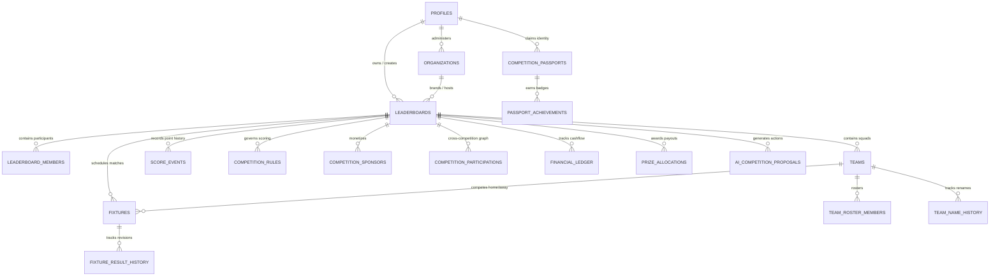

# The LeaderboardOS Technical Bible

> **The Authoritative Technical & Operational Reference for Developers, AI Coding Agents, Maintainers, and Technical Contributors.**
>
> *Last Verified:* October 27, 2026 | *Verified Git Head Commit:* Staging Baseline | *Target Runtime:* Node.js 20+, Next.js 16 (App Router), React 19, Supabase PostgreSQL 15+

---

## Table of Contents

- [1. Project Overview & Product Principles](#1-project-overview--product-principles)
- [2. Architecture Overview](#2-architecture-overview)
- [3. Repository Map](#3-repository-map)
- [4. Domain Model & Database Reference](#4-domain-model--database-reference)
- [5. Competition Engine Internals](#5-competition-engine-internals)
- [6. Authentication, Authorization & Security](#6-authentication-authorization--security)
- [7. Business Logic & Important Workflows](#7-business-logic--important-workflows)
- [8. API, Integrations, Billing & Deployment](#8-api-integrations-billing--deployment)
- [9. Testing & Quality Standards](#9-testing--quality-standards)
- [10. Architecture Decisions & Engineering Conventions](#10-architecture-decisions--engineering-conventions)
- [11. Known Limitations, Risks & Technical Debt](#11-known-limitations-risks--technical-debt)
- [12. The Seven-Era Technical Roadmap](#12-the-seven-era-technical-roadmap)
- [13. New Contributor & AI-Agent Onboarding](#13-new-contributor--ai-agent-onboarding)

---

## 1. Project Overview & Product Principles

### 1.1 What LeaderboardOS Is
**LeaderboardOS** is an open-architecture, general-purpose competition operating system designed to run competitions of any structure—spanning sports leagues, esports tournaments, corporate sales sprints, academic hackathons, and continuous fitness challenges. Rather than treating a leaderboard as a static UI widget or an isolated database table, LeaderboardOS models competitions as stateful, rule-driven event engines with auditable score provenance, participant identity management, automated scheduling, monetization capabilities, and developer extensibility.

### 1.2 Long-Term Vision: The General-Purpose Competition OS
Most competition software on the web is siloed: bracket generators do not support league standings; sports league managers do not support gaming XP scoring; corporate incentive trackers do not offer public spectator embeds. LeaderboardOS unifies these domains under a single normalized core:
- **Universal Competition Core**: Shared abstractions for participants, teams, schedules, score events, rankings, and lifecycle stages.
- **Pluggable Mechanics**: Interchangeable engines (Points, Round-Robin Leagues, Knockout Elimination Brackets) running on the same underlying relational primitives.
- **Portability of Participant Identity**: A competitor's record persists across tournaments and seasons via a decentralized, persistent handle ("Competition Passport").

### 1.3 Core Architectural Principles

1. **Reuse Common Capabilities Over Siloed Implementations**: Never build a bespoke database table or one-off scoring mechanism for a specific sport or gaming genre. New competition variations must parameterize the shared rules engine ([CompetitionRulesSettings](file:///c:/Users/DELL/Documents/leaderboard/src/components/competition/CompetitionRulesSettings.tsx)) or implement the standard engine interface in [src/lib/competition/engines/types.ts](file:///c:/Users/DELL/Documents/leaderboard/src/lib/competition/engines/types.ts).
2. **Dual-Mode Parity (Supabase + Local Demo Sandbox)**: The entire core user journey (competition creation, roster management, fixture scheduling, score updates, standings recalculation, and public viewing) must execute seamlessly in offline/demo sandbox mode without requiring Supabase API credentials. A feature that only functions in live database mode is incomplete.
3. **Immutable Score Events & Result Provenance**: Scores are never mutated with opaque in-place SQL updates. Points are awarded via discrete, append-only `score_events` rows, and fixture score revisions are recorded in `fixture_result_history` with mandatory change reasons and optional evidence URLs.
4. **Non-Destructive Evolution & Backward Compatibility**: Adding columns, migration steps, or new engines must never invalidate existing competition data, break legacy tournament brackets, or corrupt historic participant standings.

---

## 2. Architecture Overview

### 2.1 Framework & Core Technologies
- **Application Framework**: [Next.js 16.2.10](https://nextjs.org/) utilizing the App Router conventions (`src/app/`) with React Server Components (RSC) and Client Components (`'use client'`).
- **UI Engine**: [React 19.2.4](https://react.dev/) with native concurrent features.
- **Styling**: [Tailwind CSS v4](https://tailwindcss.com/) with CSS-first configuration via `@import "tailwindcss";` in `src/app/globals.css`.
- **Database & Realtime**: [Supabase](https://supabase.com/) (PostgreSQL 15+, Supabase Realtime via Postgres logical replication, Supabase Storage for media assets).
- **Client Libraries**: `@supabase/ssr` for cookie-based server auth and `@supabase/supabase-js` for browser clients.
- **Testing**: [Vitest 4.1.10](https://vitest.dev/) for unit and integration testing across 26 test suites (292 tests).
- **Language**: TypeScript 5 with strict null checking enabled.

### 2.2 System Architecture Diagram

```mermaid
graph TB
    subgraph ClientLayer ["Client & Public Layer"]
        PublicBrowser["Public Spectators\n(/leaderboards/[slug], /embed/[slug])"]
        OrganizerUI["Organizer Dashboard\n(/dashboard, /event-day, /finance)"]
        CompetitorPassport["Competitor Passport\n(/passport/[handle])"]
        ExternalAPI["External Systems & Gamers\n(/api/v1/...)"]
    end

    subgraph NextJSRuntime ["Next.js 16 App Router Runtime"]
        Middleware["middleware.ts\n(Session Refresh & Subdomain Routing)"]
        RSC["Server Components (RSC)\n(Layouts, Initial Page Payload)"]
        RouteHandlers["API Route Handlers\n(/api/v1/*, /api/payments/*)"]
        AuthCtx["AuthContext.tsx\n(Supabase Auth + Mock Fallback)"]
    end

    subgraph DomainServices ["Domain Services (src/lib/)"]
        DBService["DatabaseService (db.ts)\n(Unified Data Access)"]
        RulesEngine["Rules & Standings Evaluator\n(evaluator.ts, standings.ts)"]
        SchedulerEngine["Scheduling Engine\n(engine.ts, service.ts)"]
        AiManager["AI Competition Manager\n(AiService, Executor, Context)"]
        GraphService["CompetitionGraphService\n(Analytics, History, Export)"]
        PaymentCore["Payment Service\n(Paystack, Ledger, Prizes)"]
    end

    subgraph PersistenceLayer ["Dual Persistence Layer"]
        subgraph LiveMode ["Live Mode (Configured)"]
            SupabasePG[("Supabase PostgreSQL\n(Tables, Views, Triggers, RLS)")]
            SupabaseRT["Supabase Realtime\n(PostgreSQL Replication Publication)"]
            SupabaseStorage["Supabase Storage\n('leaderboard-media' Bucket)"]
        end
        subgraph DemoMode ["Demo Sandbox Mode (Zero-Config)"]
            LocalStorage[("window.localStorage\n(Browser Client State)")]
            InMemoryMap[("Node.js inMemoryStore\n(SSR, API Routes, Vitest)")]
        end
    end

    PublicBrowser --> Middleware --> RSC
    OrganizerUI --> Middleware --> RSC
    OrganizerUI --> AuthCtx
    ExternalAPI --> RouteHandlers

    RSC --> DBService
    RouteHandlers --> DBService
    AuthCtx --> DBService

    DBService --> RulesEngine
    DBService --> SchedulerEngine
    DBService --> AiManager
    DBService --> GraphService
    DBService --> PaymentCore

    DBService -.->|Keys Present| SupabasePG
    DBService -.->|Realtime Events| SupabaseRT
    DBService -.->|Keys Absent (Browser)| LocalStorage
    DBService -.->|Keys Absent (Server/Tests)| InMemoryMap
```

### 2.3 Request and Data Flow
1. **Public Spectator Request (`/leaderboards/[slug]`)**:
   - Next.js Server Component retrieves initial competition state, standings, scoring rules, and active sponsors via `DatabaseService.getLeaderboardBySlug()`.
   - HTML is streamed with high-contrast standings podium.
   - Client Component mounts and establishes a Supabase Realtime channel listening to `INSERT` on `score_events` (or polling interval in demo mode). Standings animate in real time when score events arrive.
2. **Organizer Score Entry Request**:
   - Organizer inputs score delta or fixture result in dashboard.
   - Handled via `DatabaseService.addScoreEvent()` or `DatabaseService.submitFixtureResult()`.
   - Database trigger checks RLS policies: only authenticated owner or assigned admin can write.
   - Result revision is archived into `fixture_result_history`; new score event triggers automatic recalculation of `league_standings` and tournament match advancement.
3. **Developer API Request (`/api/v1/competitions/[idOrSlug]/scores`)**:
   - Middleware/Route handler validates `X-API-Key` or Bearer token against SHA-256 hashed keys in `api_keys`.
   - Enforces token bucket rate limiting (100 req/min).
   - Validates payload against Zod schema and records score event with `author_type: 'api_client'`.

### 2.4 Dual-Mode Storage Architecture
To guarantee that the application runs locally and evaluates deterministically without external credentials, the persistence layer implements ADR-0001:
- **Environment Detection**: If `process.env.NEXT_PUBLIC_SUPABASE_URL` and `process.env.NEXT_PUBLIC_SUPABASE_ANON_KEY` are undefined or placeholder strings, `DatabaseService.isConfigured()` returns `false`.
- **Browser Execution**: Reads and writes serialize to `window.localStorage` under key namespaces (`leaderboardos_competitions`, `leaderboardos_fixtures`, `leaderboardos_members`).
- **Server/Test Execution**: When executing under Vitest or SSR without window access, data routes to in-memory Maps (`inMemoryStore`), pre-seeded with rich sample competitions across sports, esports, and corporate domains.

---

## 3. Repository Map

```text
c:\Users\DELL\Documents\leaderboard\
├── docs/                                    # Documentation repository
│   ├── DOCUMENTATION_POLICY.md              # Mandatory documentation lifecycle policy
│   ├── FEATURE_DOCUMENTATION_CHECKLIST.md   # PR & agent task checklist template
│   ├── feature-registry.json                # Machine-readable feature catalog
│   ├── api.md                               # API endpoint reference
│   ├── payments.md                          # Paystack billing & financial flows
│   ├── external-scoring-connectors.md       # Hardware/gaming webhook specifications
│   ├── technical/
│   │   ├── LEADERBOARDOS_TECHNICAL_BIBLE.md # (This document) Authoritative technical guide
│   │   └── decisions/                       # Architecture Decision Records (ADRs)
│   │       ├── 0001-hybrid-dual-mode-architecture.md
│   │       ├── 0002-append-only-result-audit-log.md
│   │       ├── 0003-multi-engine-abstraction.md
│   │       ├── 0004-ai-grounded-manager-with-proposals.md
│   │       └── 0005-relational-graph-without-graph-db.md
│   └── user/
│       └── LEADERBOARDOS_USER_GUIDE.md      # Authoritative user guide & client demo playbook
├── src/
│   ├── app/                                 # Next.js 16 App Router pages & API routes
│   │   ├── (seo)/[slug]/page.tsx            # Programmatic landing pages (e.g. /fifa-tournament-maker)
│   │   ├── api/                             # Internal and developer REST API endpoints
│   │   │   ├── admin/seo/diagnostics/       # SEO health audit endpoint
│   │   │   ├── competitions/[idOrSlug]/     # Assistant chat, proposals, finance, sponsors, registration
│   │   │   ├── developer/keys/              # API key issuance and rotation
│   │   │   ├── developer/webhooks/          # Webhook delivery telemetry
│   │   │   ├── og/share/                    # Dynamic OpenGraph image generation
│   │   │   ├── organizations/               # Org branding, audit, domain management
│   │   │   ├── payments/                    # Paystack checkout, webhooks, verification
│   │   │   └── v1/                          # Public developer API v1 (competitions, scores, analytics)
│   │   ├── dashboard/                       # Authenticated organizer control center
│   │   │   ├── admin/billing/               # Platform-wide revenue & subscription monitoring
│   │   │   ├── analytics/                   # Cross-competition data graph analytics & export
│   │   │   ├── billing/                     # Customer SaaS plan subscription portal
│   │   │   ├── create/                      # Multi-step competition creation wizard
│   │   │   ├── developer/                   # API keys and webhook manager
│   │   │   ├── leaderboards/[id]/           # Competition dashboard (scores, standings, fixtures)
│   │   │   │   ├── event-day/               # Matchday operator live console
│   │   │   │   └── finance/                 # Financial ledger, prize payouts, sponsor tracker
│   │   │   └── organizations/               # Multi-tenant workspace management
│   │   ├── directory/                       # Public competition discovery marketplace
│   │   ├── embed/[slug]/                    # Stripped iframe embed route
│   │   ├── leaderboards/[slug]/             # Public spectator standings view
│   │   ├── login/                           # Authentication portal (Email & OAuth)
│   │   ├── passport/[handle]/               # Public competitor passport & achievement profile
│   │   └── tools/                           # Standalone browser tools (Elo calc, league generator)
│   ├── components/                          # Reusable UI component library
│   │   ├── ai/AiAssistantPanel.tsx          # Grounded AI co-pilot chat & proposal review UI
│   │   ├── analytics/CrossCompetitionAnalyticsView.tsx # Graph analytics and CSV export
│   │   ├── competition/                     # Rules settings, audit drawer, templates, scheduler
│   │   ├── discovery/                       # Marketplace search, filter bar, cards, modals
│   │   ├── league/                          # League standings tables, fixture management
│   │   ├── tournament/                      # Interactive knockout bracket renderer
│   │   └── teams/TeamRosterManagement.tsx   # Squad management and player transfers
│   ├── context/
│   │   └── AuthContext.tsx                  # Supabase session provider + local mock fallback
│   ├── lib/                                 # Domain services and core competition business logic
│   │   ├── ai/                              # Context grounding, providers, proposal execution
│   │   ├── analytics/competition-graph.ts   # Relational data graph queries and CSV streamer
│   │   ├── api/                             # API key crypto, HMAC signatures, rate limiters
│   │   ├── billing/                         # Subscription guards, entitlement resolution
│   │   ├── competition/                     # Rules, scheduling, event-day, passport, lifecycle
│   │   ├── db.ts                            # Unified DatabaseService access layer & demo fixtures
│   │   ├── league/                          # League standings calculation & tie-breaker evaluation
│   │   ├── payments/                        # Paystack provider, financial ledger, prize pool
│   │   └── tournament/                      # Bracket generation, match progression, seeding
│   └── types/
│       └── index.ts                         # Canonical TypeScript models and schema definitions
├── supabase/
│   └── migrations/                          # 26 incremental PostgreSQL schema migrations
├── tests/                                   # Vitest automated test suites (26 files, 292 tests)
├── package.json                             # Dependencies and scripts (test, lint, build, docs:validate)
├── AGENTS.md                                # Canonical AI coding agent and contributor guidelines
└── vitest.config.ts                         # Vitest runner configuration
```

---

## 4. Domain Model & Database Reference

### 4.1 Entity Relationship Diagram



### 4.2 Core Database Tables & Data Dictionary

| Table Name | Purpose | Key Columns | Primary Constraints & Indexes | Services Depending On It |
| :--- | :--- | :--- | :--- | :--- |
| `profiles` | User identity & platform roles | `id (UUID PK)`, `email`, `role`, `created_at` | References `auth.users(id)` ON DELETE CASCADE | [AuthContext](file:///c:/Users/DELL/Documents/leaderboard/src/context/AuthContext.tsx), [BillingService](file:///c:/Users/DELL/Documents/leaderboard/src/lib/billing/access.ts) |
| `leaderboards` | Root competition entity | `id (UUID PK)`, `title`, `slug (UNIQUE)`, `competition_type`, `status`, `owner_id`, `organization_id` | `UNIQUE(slug)`, Check: `competition_type IN ('simple_points', 'league_table', 'tournament')` | [DatabaseService](file:///c:/Users/DELL/Documents/leaderboard/src/lib/db.ts), [LifecycleService](file:///c:/Users/DELL/Documents/leaderboard/src/lib/competition/lifecycle/service.ts) |
| `leaderboard_members`| Registered individuals | `id`, `leaderboard_id`, `name`, `score`, `rank`, `team_id` | Foreign keys to `leaderboards` and `teams`; indexed on `(leaderboard_id, score DESC)` | [DatabaseService](file:///c:/Users/DELL/Documents/leaderboard/src/lib/db.ts) |
| `teams` | Squads / clubs in leagues | `id`, `leaderboard_id`, `name`, `logo_url`, `captain_id` | Indexed on `(leaderboard_id, name)` | [TeamService](file:///c:/Users/DELL/Documents/leaderboard/src/components/teams/TeamRosterManagement.tsx), [DatabaseService](file:///c:/Users/DELL/Documents/leaderboard/src/lib/db.ts) |
| `fixtures` | Scheduled or completed matches | `id`, `leaderboard_id`, `home_team_id`, `away_team_id`, `home_score`, `away_score`, `status`, `round_number` | Check: `status IN ('scheduled', 'in_progress', 'completed', 'postponed', 'cancelled')` | [SchedulingService](file:///c:/Users/DELL/Documents/leaderboard/src/lib/competition/scheduling/service.ts), [StandingsService](file:///c:/Users/DELL/Documents/leaderboard/src/lib/league/standings.ts) |
| `fixture_result_history`| Audit log of score submissions | `id`, `fixture_id`, `home_score`, `away_score`, `submitted_by`, `change_reason`, `revision_number` | Foreign key to `fixtures(id)` ON DELETE CASCADE; indexed on `(fixture_id, revision_number DESC)` | [AuditService](file:///c:/Users/DELL/Documents/leaderboard/src/lib/competition/audit/service.ts) |
| `score_events` | Append-only points entries | `id`, `leaderboard_id`, `member_id`, `points_delta`, `rule_id`, `created_by`, `created_at` | Read-only / append-only RLS policies; Realtime enabled publication | [DatabaseService](file:///c:/Users/DELL/Documents/leaderboard/src/lib/db.ts) |
| `competition_rules` | Scoring and tie-breaker specs | `id`, `leaderboard_id`, `points_per_win`, `points_per_draw`, `tie_breaker_hierarchy` | Foreign key to `leaderboards(id)`; JSONB validation for tie-breaker order | [RulesService](file:///c:/Users/DELL/Documents/leaderboard/src/lib/competition/rules/service.ts) |
| `competition_participations`| Cross-competition graph | `id`, `competition_id`, `team_id`, `participant_id`, `matches_played`, `matches_won`, `final_rank` | Foreign keys to `leaderboards`, `teams`, `profiles`; composite indexes on `(team_id, competition_id)` | [CompetitionGraphService](file:///c:/Users/DELL/Documents/leaderboard/src/lib/analytics/competition-graph.ts) |
| `team_name_history` | Historic team renames | `id`, `team_id`, `former_name`, `effective_until` | Foreign key to `teams(id)`; tracks rebrands without breaking past match audit | [CompetitionGraphService](file:///c:/Users/DELL/Documents/leaderboard/src/lib/analytics/competition-graph.ts) |
| `financial_ledger` | Inflow/outflow transactions | `id`, `competition_id`, `transaction_type`, `amount_kobo`, `currency`, `reference_id` | Check: `transaction_type IN ('registration_fee', 'sponsorship_payout', 'prize_distribution', 'refund')` | [FinanceService](file:///c:/Users/DELL/Documents/leaderboard/src/lib/payments/competition/service.ts) |
| `api_keys` | Developer authentication | `id`, `user_id`, `key_prefix`, `key_hash`, `scopes`, `revoked_at` | Unique on `key_hash`; scopes stored as text array | [ApiAuth](file:///c:/Users/DELL/Documents/leaderboard/src/lib/api/auth.ts) |

---

## 5. Competition Engine Internals

LeaderboardOS provides three fully implemented competition engines, each conforming to the engine specification defined in [src/lib/competition/engines/types.ts](file:///c:/Users/DELL/Documents/leaderboard/src/lib/competition/engines/types.ts):

### 5.1 Simple Points Leaderboard Engine
- **Core Concept**: Continuous ranking of individuals or teams based on accumulated or single-highest score points.
- **Data Path**: Writes to `score_events` via `DatabaseService.addScoreEvent()`. Member total score is deterministically updated by summing all active score events for that member.
- **Tie Handling**: Tied members share rank (e.g., both Rank 2), and subsequent ranks advance accordingly (1, 2, 2, 4).
- **Realtime Trigger**: The `score_events` table is subscribed via Supabase Realtime channel. Incoming point events animate the public leaderboard podium and sound audio/confetti effects in [LeaderboardView](file:///c:/Users/DELL/Documents/leaderboard/src/app/leaderboards/[slug]/LeaderboardView.tsx).

### 5.2 League Table Engine
- **Core Concept**: Structured round-robin schedule where teams play fixtures, receiving league table points based on match outcomes.
- **Standings Computation ([standings.ts](file:///c:/Users/DELL/Documents/leaderboard/src/lib/league/standings.ts))**:
  $$\text{Points} = (\text{Wins} \times \text{points\_per\_win}) + (\text{Draws} \times \text{points\_per\_draw})$$
  $$\text{Goal Differential (GD)} = \text{Goals For (GF)} - \text{Goals Against (GA)}$$
- **Tie-Breaker Hierarchy**: Configurable via [CompetitionRules](file:///c:/Users/DELL/Documents/leaderboard/src/lib/competition/rules/evaluator.ts) with prioritized cascades:
  1. Points
  2. Goal/Point Differential
  3. Goals/Points Scored
  4. Head-to-Head record between tied teams
  5. Fewest Red/Yellow Fair Play cards
  6. Alphabetical coin-toss fallback

### 5.3 Knockout Tournament Engine
- **Core Concept**: Binary tree single elimination bracket with power-of-two participant structures (4, 8, 16, 32, 64 teams).
- **Match Progression ([service.ts](file:///c:/Users/DELL/Documents/leaderboard/src/lib/tournament/service.ts))**:
  When a match is finalized with a winning team ID:
  $$\text{Next Match Slot} = \lfloor \text{Match Index} / 2 \rfloor$$
  The winner automatically advances to the calculated parent match slot in the next round (`Quarter-Final` $\rightarrow$ `Semi-Final` $\rightarrow$ `Final`).
- **Bracket Rendering**: Interactive SVG and flexbox bracket rendered via [TournamentPublicView](file:///c:/Users/DELL/Documents/leaderboard/src/components/tournament/TournamentPublicView.tsx) supporting zoom, panning, and match detail modal inspections.

### 5.4 AI Competition Manager Internals
- **Grounded Assistant Architecture**: Built on ADR-0004 to eliminate hallucinated tournament actions.
- **Context Synthesis ([context.ts](file:///c:/Users/DELL/Documents/leaderboard/src/lib/ai/context.ts))**: Compiles current standings, upcoming fixtures, registered participants, and scoring rules into a JSON context payload before sending queries to Google Gemini, OpenAI, or local heuristics.
- **Two-Phase Action Proposals**: Any database mutation suggested by AI (e.g., generating round-robin fixtures or updating win points) is returned as a typed JSON proposal conforming to [ProposalPayloadSchema](file:///c:/Users/DELL/Documents/leaderboard/src/lib/ai/proposals/schemas.ts). The organizer must explicitly review the diff and click **"Apply Changes"** in [AiAssistantPanel](file:///c:/Users/DELL/Documents/leaderboard/src/components/ai/AiAssistantPanel.tsx), which then executes via [AiProposalExecutor](file:///c:/Users/DELL/Documents/leaderboard/src/lib/ai/proposals/executor.ts).

---

## 6. Authentication, Authorization & Security

### 6.1 Authentication Architecture
- **Supabase Auth**: Backed by JSON Web Tokens (JWT) stored in HTTP-only, Secure SameSite cookies managed by `@supabase/ssr`.
- **Supported Methods**: Email Magic Links, Email/Password, and Google OAuth.
- **Demo Fallback Auth**: In sandbox mode, `AuthContext.tsx` maintains a local mock profile (`demo-organizer@leaderboardos.local`) with simulated admin privileges, enabling complete offline testing.

### 6.2 Role-Based Access Control (RBAC) & Ownership
1. **Platform Super Admin (`profiles.role = 'admin'`)**: Can inspect global billing metrics (`/api/payments/admin/metrics`), impersonate or audit organizations, and view system health diagnostics.
2. **Competition Owner (`leaderboards.owner_id = auth.uid()`)**: Full administrative control to edit rules, schedule matches, adjust standings, submit scores, and manage prize payouts.
3. **Delegated Referee / Admin**: Assigned in `leaderboard_admins` table; permitted to submit fixture scores and verify attendee check-ins, but restricted from deleting competitions or modifying financial settings.
4. **Participant**: Can claim participant passport, register for open competitions, submit squad rosters, and report dispute flags.
5. **Public Spectator**: Read-only access to published public leaderboards, brackets, and embeds.

### 6.3 Row Level Security (RLS) Policies
PostgreSQL RLS is enabled on all production tables. Representative security policies include:
- `leaderboards`: Selectable if `is_public = true` OR `owner_id = auth.uid()` OR `auth.uid() IN (SELECT user_id FROM leaderboard_admins WHERE leaderboard_id = id)`.
- `score_events`: INSERT permitted only by competition owner or delegated admin. Direct UPDATE and DELETE statements are denied by RLS policy.
- `financial_ledger`: Accessible only by competition owner or platform super admin.

### 6.4 Developer API & Webhook Security
- **API Keys**: Keys are issued with format `lb_live_<32_random_bytes>`. The database stores only the SHA-256 hash (`key_hash`) and a public prefix (`key_prefix`). Unhashed raw keys are shown to the developer exactly once upon generation.
- **HMAC Signatures**: Webhook outbound HTTP POST requests include an `X-LeaderboardOS-Signature` header computed as `HMAC-SHA256(payload, webhook_secret)` so receivers can cryptographically verify payload integrity.
- **Rate Limiting**: Enforced in memory via [rateLimiter.ts](file:///c:/Users/DELL/Documents/leaderboard/src/lib/api/rateLimiter.ts) at 100 requests per minute per IP or API key.

---

## 7. Business Logic & Important Workflows

### 7.1 Creating a Competition
1. Organizer navigates to `/dashboard/create` and selects a template (Football League, Esports Knockout, Corporate Sales Sprint).
2. The wizard configures `title`, `slug`, `competition_type`, and `visibility`.
3. In [src/app/dashboard/create/page.tsx](file:///c:/Users/DELL/Documents/leaderboard/src/app/dashboard/create/page.tsx), `DatabaseService.createLeaderboard()` writes the record, initializes default `competition_rules`, creates sample venues, and routes the user to `/dashboard/leaderboards/[id]`.

### 7.2 Participant & Team Registration
- **Direct Entry**: Organizer adds members manually via CSV upload or single-form entry in dashboard.
- **Public Self-Registration**: When competition lifecycle is set to `'registration'`, public visitors submit entry forms on `/leaderboards/[slug]`. If registration fee is configured, participant is redirected to Paystack checkout before enrollment is finalized in `competition_registrations`.

### 7.3 Fixture Scheduling & Round-Robin Generator
- Located in [src/lib/competition/scheduling/engine.ts](file:///c:/Users/DELL/Documents/leaderboard/src/lib/competition/scheduling/engine.ts).
- Uses the standard polygon/circle rotation algorithm to generate balanced home-and-away round-robin pairings for any count of teams $N$ (adding a virtual bye if $N$ is odd).
- Automatically staggers matches across specified venues (e.g. "Main Pitch", "Court 1") and time slots (e.g. 60-minute match intervals).

### 7.4 Result Entry, Dispute Corrections & Audit Linage
1. Referee or organizer enters match score in dashboard or live event console (`/event-day`).
2. `DatabaseService.submitFixtureResult()` stores the score.
3. If an existing finalized score is modified, `AuditService.recordFixtureResultChange()` stores the previous score in `fixture_result_history`, increments `revision_number`, records the author's mandatory reason, and triggers a re-evaluation of league standings.

### 7.5 Multi-Stage Competition Pathways
- Configured via [PathwayService](file:///c:/Users/DELL/Documents/leaderboard/src/lib/competition/pathway/service.ts).
- Organizers connect a "Group Stage" league to a "Playoff" knockout tournament.
- Upon finalizing the league, top $K$ teams are automatically seeded into corresponding slots in the playoff tournament bracket.

---

## 8. API, Integrations, Billing & Deployment

### 8.1 Developer REST API v1
All developer endpoints are mounted under `/api/v1/`:
- `GET /api/v1/competitions`: List owned or public competitions.
- `GET /api/v1/competitions/[idOrSlug]`: Retrieve detailed metadata, rules, and stages.
- `POST /api/v1/competitions/[idOrSlug]/scores`: Submit batch score events with idempotency tokens.
- `GET /api/v1/competitions/[idOrSlug]/standings`: Retrieve computed league standings.
- `GET /api/v1/competitions/[idOrSlug]/fixtures`: Query match schedules and scores.
- `GET /api/v1/analytics/cross-competition`: Query relational graph performance metrics.
- `GET /api/v1/analytics/export`: Stream RFC 4180 compliant CSV analytics.

### 8.2 Billing, Paystack Integration & Entitlements
- **Provider**: [Paystack](https://paystack.com/) for NGN transactions; extensible interface for Stripe/Flutterwave in [src/lib/payments/providers/](file:///c:/Users/DELL/Documents/leaderboard/src/lib/payments/providers/).
- **SaaS Tiers**:
  - `free`: Up to 2 competitions, 32 participants per competition.
  - `pro` (₦10,000 / month): Unlimited competitions, 256 participants, custom branding, API keys, AI manager.
  - `business` (₦50,000 / month): Unlimited participants, custom subdomains, priority webhooks, multi-admin teams.
- **Entitlement Checks**: Enforced server-side via [src/lib/billing/guards.ts](file:///c:/Users/DELL/Documents/leaderboard/src/lib/billing/guards.ts) preventing tier escalation on the database write path.

### 8.3 Environment Variables Reference

| Variable Name | Required Live? | Required Demo? | Description | Example / Sanitized Value |
| :--- | :--- | :--- | :--- | :--- |
| `NEXT_PUBLIC_SUPABASE_URL` | Yes | No | Supabase Project API URL | `https://xyzproject.supabase.co` |
| `NEXT_PUBLIC_SUPABASE_ANON_KEY`| Yes | No | Public Supabase Anonymous Key | `eyJhbGciOiJIUzI1Ni...` |
| `SUPABASE_SERVICE_ROLE_KEY` | For Admin | No | Bypasses RLS for migrations/webhooks | `eyJhbGciOiJIUzI1Ni...` |
| `PAYSTACK_SECRET_KEY` | For Billing| No | Paystack Secret API Key | `sk_live_...` |
| `PAYSTACK_PUBLIC_KEY` | For Billing| No | Paystack Inline Checkout Key | `pk_live_...` |
| `PAYSTACK_WEBHOOK_SECRET` | For Billing| No | Validates Paystack IPN payloads | `whsec_...` |
| `AI_PROVIDER` | Optional | No | AI Model (`auto`, `gemini`, `openai`) | `auto` |
| `GEMINI_API_KEY` | For Live AI| No | Google Gemini API Key | `AIzaSy...` |
| `NEXT_PUBLIC_APP_URL` | Yes | No | Canonical app domain URL | `https://leaderboardos.com` |

### 8.4 Deployment & Migration Runbook
- **Hosting**: Deployed on Vercel or any Node.js container platform.
- **Build Command**: `npm run build`
- **Database Migrations**: Applied incrementally via Supabase CLI or Supabase SQL Editor in numeric sequence from `supabase/migrations/202607050001_initial_schema.sql` through `supabase/migrations/202611040001_competition_data_graph_and_analytics.sql`.
- **Zero-Downtime Rule**: Migrations must only add additive tables, non-null columns with defaults, or non-destructive triggers. Never drop or rename columns without a multi-phase deprecation cycle.

---

## 9. Testing & Quality Standards

### 9.1 Test Organization
LeaderboardOS maintains 26 Vitest test suites containing 292 passing automated tests:
```text
tests/
├── activity/cross-engine-logging.test.ts          # Unified audit logging across all engines
├── ai/ai-competition-manager.test.ts              # Proposal schema, limits, grounded local executor
├── analytics/competition-data-graph.test.ts       # Graph queries, team history, CSV export
├── api/v1/secure-api.test.ts                      # API keys, hashing, rate limiting, scopes
├── competition/
│   ├── achievements-and-ratings.test.ts           # Elo calculation and badge unlock criteria
│   ├── lifecycle-and-pathways.test.ts             # State machine & multi-stage bracket seeding
│   ├── marketplace-discovery.test.ts              # Filter queries, category matching
│   ├── passport-and-claims.test.ts                # Participant passports and handle uniqueness
│   ├── registration-and-notifications.test.ts     # Public registration and capacity caps
│   ├── result-history.test.ts                     # Result revision audit logs and reasons
│   ├── rules-engine.test.ts                       # Head-to-head tie-breaker rules
│   ├── scheduler.test.ts                          # Polygon round-robin algorithm and venue conflicts
│   ├── sponsorship.test.ts                        # Sponsor placement, clicks and impressions
│   └── templates-and-event-day.test.ts            # Preset initialization and live match timers
├── discovery/demo-directory.test.ts               # Public directory rendering in demo mode
├── embed/embed-parity.test.ts                     # iFrame parameter parity
├── organizations/organizations-and-branding.test.ts# Multi-tenant branding and audit logs
├── payments/                                      # Access checks, admin roles, ledger, webhooks
├── permissions/leaderboard-access.test.ts         # Ownership, referee, and viewer permissions
├── seeding/league-standings-seeding.test.ts       # Seeding knockout tournaments from league rank
├── sharing/shareable-results.test.ts              # Result card generation and dynamic OG routes
└── teams/teams-and-rosters.test.ts                # Roster limits, squad transfers, captaincy
```

### 9.2 Quality Gate for Commits & Pull Requests
Before committing code or submitting pull requests, contributors must pass:
1. `npm run test`: All 292 tests must pass in under 5 seconds.
2. `npm run docs:validate`: Documentation integrity validator must return 0 errors.
3. `npm run build`: Production Next.js compilation must succeed without type or lint errors.

---

## 10. Architecture Decisions & Engineering Conventions

### 10.1 Architecture Decision Records (ADR) Index
Major technical decisions are recorded under `docs/technical/decisions/`:
- [ADR-0001: Hybrid Dual-Mode Persistence Architecture](file:///c:/Users/DELL/Documents/leaderboard/docs/technical/decisions/0001-hybrid-dual-mode-architecture.md)
- [ADR-0002: Append-Only Immutable Score Event Log and Historical Result Provenance](file:///c:/Users/DELL/Documents/leaderboard/docs/technical/decisions/0002-append-only-result-audit-log.md)
- [ADR-0003: Multi-Engine Competition Abstraction](file:///c:/Users/DELL/Documents/leaderboard/docs/technical/decisions/0003-multi-engine-abstraction.md)
- [ADR-0004: Grounded AI Competition Assistant with Structured Proposal Execution](file:///c:/Users/DELL/Documents/leaderboard/docs/technical/decisions/0004-ai-grounded-manager-with-proposals.md)
- [ADR-0005: Relational Data Graph and Analytics Layer within PostgreSQL](file:///c:/Users/DELL/Documents/leaderboard/docs/technical/decisions/0005-relational-graph-without-graph-db.md)

### 10.2 Engineering Conventions
- **Domain Service Encapsulation**: Never query Supabase directly in React components. Access all state through domain services in `src/lib/` or `DatabaseService`.
- **Type Safety**: Reuse canonical types in [src/types/index.ts](file:///c:/Users/DELL/Documents/leaderboard/src/types/index.ts). Never define loose `any` casts in competition score paths.
- **Fail-Safe Fallbacks**: Any external service call (Paystack, Gemini, Supabase Realtime) must handle network partitions gracefully with user-friendly notices rather than crashing the interface.

---

## 11. Known Limitations, Risks & Technical Debt

| Item | Severity | Impact | Code Location | Remediation Strategy | Status |
| :--- | :--- | :--- | :--- | :--- | :--- |
| **Double Elimination Tournament Brackets** | Low | Knockout engine currently supports single-elimination brackets; double-elimination losers brackets require manual scheduling. | `src/lib/tournament/service.ts` | Extend tournament match model with `bracket_type: 'winners' \| 'losers'` in future release. | Planned |
| **In-Memory Rate Limiting** | Medium | API key rate limiting is held in Node memory. Multiple serverless lambdas do not share counter state. | `src/lib/api/rateLimiter.ts` | Transition to Upstash Redis or Supabase PostgreSQL token bucket table for distributed edge deployments. | Technical Debt |
| **Client-Side Tie Re-evaluation** | Low | In demo mode, tie-breaker recalculation runs synchronously in browser JavaScript. Datasets with >500 teams may exhibit frame drops. | `src/lib/league/standings.ts` | Offload tie-breaker recomputation to Web Workers in demo mode. | Minor Debt |
| **Offline Image Asset Storage** | Low | In demo sandbox mode, image uploads use local data URIs which can inflate `localStorage` limits (5MB browser cap). | `src/lib/image-upload.ts` | Enforce client-side image compression and max 150KB dimensions in demo mode. | Implemented Guard |

---

## 12. The Seven-Era Technical Roadmap

Every feature across all seven eras is labeled with its explicit implementation status:
`Implemented` | `Partially implemented` | `Planned` | `Experimental` | `Requires configuration` | `Unverified`

### Era 1: Foundation
- **Simple Points Leaderboard Engine**: `Implemented` ([src/lib/competition/engines/simple/](file:///c:/Users/DELL/Documents/leaderboard/src/lib/competition/engines/simple/))
- **Dual-Mode Persistence (Supabase + localStorage/mockDb)**: `Implemented` ([src/lib/db.ts](file:///c:/Users/DELL/Documents/leaderboard/src/lib/db.ts))
- **Public High-Contrast Podium & Standings**: `Implemented` ([src/app/leaderboards/[slug]/page.tsx](file:///c:/Users/DELL/Documents/leaderboard/src/app/leaderboards/[slug]/page.tsx))
- **Responsive iFrame Embed System**: `Implemented` ([src/app/embed/[slug]/page.tsx](file:///c:/Users/DELL/Documents/leaderboard/src/app/embed/[slug]/page.tsx))

### Era 2: Organizer OS
- **Round-Robin League Table Engine**: `Implemented` ([src/lib/league/service.ts](file:///c:/Users/DELL/Documents/leaderboard/src/lib/league/service.ts))
- **Single-Elimination Knockout Engine**: `Implemented` ([src/lib/tournament/service.ts](file:///c:/Users/DELL/Documents/leaderboard/src/lib/tournament/service.ts))
- **Configurable Rules & Tie-Breakers**: `Implemented` ([src/lib/competition/rules/service.ts](file:///c:/Users/DELL/Documents/leaderboard/src/lib/competition/rules/service.ts))
- **Automated Round-Robin Scheduler**: `Implemented` ([src/lib/competition/scheduling/service.ts](file:///c:/Users/DELL/Documents/leaderboard/src/lib/competition/scheduling/service.ts))
- **Append-Only Result Audit Log**: `Implemented` ([src/lib/competition/audit/service.ts](file:///c:/Users/DELL/Documents/leaderboard/src/lib/competition/audit/service.ts))
- **Multi-Stage Pathways (League to Playoffs)**: `Implemented` ([src/lib/competition/pathway/service.ts](file:///c:/Users/DELL/Documents/leaderboard/src/lib/competition/pathway/service.ts))
- **Live Matchday Event Console**: `Implemented` ([src/app/dashboard/leaderboards/[id]/event-day/page.tsx](file:///c:/Users/DELL/Documents/leaderboard/src/app/dashboard/leaderboards/[id]/event-day/page.tsx))

### Era 3: Participant Network
- **Competitor Passports & Public Handles**: `Implemented` ([src/app/passport/[handle]/page.tsx](file:///c:/Users/DELL/Documents/leaderboard/src/app/passport/[handle]/page.tsx))
- **Team Roster & Squad Management**: `Implemented` ([src/components/teams/TeamRosterManagement.tsx](file:///c:/Users/DELL/Documents/leaderboard/src/components/teams/TeamRosterManagement.tsx))
- **Public Registration & Attendance Tracking**: `Implemented` ([src/lib/competition/registration/service.ts](file:///c:/Users/DELL/Documents/leaderboard/src/lib/competition/registration/service.ts))
- **Elo/Glicko Ratings & Achievement Badges**: `Implemented` ([src/lib/competition/ratings/service.ts](file:///c:/Users/DELL/Documents/leaderboard/src/lib/competition/ratings/service.ts))
- **Dynamic OpenGraph Result Sharing**: `Implemented` ([src/app/api/og/share/route.tsx](file:///c:/Users/DELL/Documents/leaderboard/src/app/api/og/share/route.tsx))

### Era 4: Competition Marketplace
- **Public Directory & Category Taxonomy**: `Implemented` ([src/app/directory/page.tsx](file:///c:/Users/DELL/Documents/leaderboard/src/app/directory/page.tsx))
- **Programmatic SEO Landing Pages**: `Implemented` ([src/app/(seo)/[slug]/page.tsx](file:///c:/Users/DELL/Documents/leaderboard/src/app/(seo)/[slug]/page.tsx))
- **Printable Tournament Brackets & Excel Downloads**: `Implemented` ([src/app/resources/page.tsx](file:///c:/Users/DELL/Documents/leaderboard/src/app/resources/page.tsx))

### Era 5: Infrastructure
- **Developer REST API v1 (Scoped Keys)**: `Implemented` ([src/app/api/v1/competitions/route.ts](file:///c:/Users/DELL/Documents/leaderboard/src/app/api/v1/competitions/route.ts))
- **Outbound Webhooks with HMAC Signatures**: `Implemented` ([src/app/api/v1/webhooks/route.ts](file:///c:/Users/DELL/Documents/leaderboard/src/app/api/v1/webhooks/route.ts))
- **Organization Workspaces & Custom Domains**: `Implemented` ([src/lib/organization/service.ts](file:///c:/Users/DELL/Documents/leaderboard/src/lib/organization/service.ts))

### Era 6: Money
- **SaaS Subscription Billing (Paystack)**: `Requires configuration` ([src/lib/payments/providers/paystack.ts](file:///c:/Users/DELL/Documents/leaderboard/src/lib/payments/providers/paystack.ts))
- **Paid Competition Registration Fees**: `Requires configuration` ([src/lib/payments/competition/service.ts](file:///c:/Users/DELL/Documents/leaderboard/src/lib/payments/competition/service.ts))
- **Competition Financial Ledger & Prize Allocations**: `Implemented` ([src/app/dashboard/leaderboards/[id]/finance/page.tsx](file:///c:/Users/DELL/Documents/leaderboard/src/app/dashboard/leaderboards/[id]/finance/page.tsx))
- **Sponsorship Tier Management & Banner Tracking**: `Implemented` ([src/lib/competition/sponsorship/service.ts](file:///c:/Users/DELL/Documents/leaderboard/src/lib/competition/sponsorship/service.ts))

### Era 7: Global Competition Network
- **AI Competition Manager (Grounded Co-Pilot)**: `Implemented` ([src/lib/ai/service.ts](file:///c:/Users/DELL/Documents/leaderboard/src/lib/ai/service.ts))
- **Normalized Relational Data Graph**: `Implemented` ([src/lib/analytics/competition-graph.ts](file:///c:/Users/DELL/Documents/leaderboard/src/lib/analytics/competition-graph.ts))
- **Cross-Competition Analytics & CSV Streamer**: `Implemented` ([src/app/api/v1/analytics/export/route.ts](file:///c:/Users/DELL/Documents/leaderboard/src/app/api/v1/analytics/export/route.ts))
- **External Hardware/Gaming Scoring Webhook Ingestion**: `Requires configuration` ([docs/external-scoring-connectors.md](file:///c:/Users/DELL/Documents/leaderboard/docs/external-scoring-connectors.md))
- **Decentralized Multi-Region P2P Federation**: `Planned` (Architectural evaluation slated for post-Era 7).

---

## 13. New Contributor & AI-Agent Onboarding

### 13.1 Mandatory Onboarding Walkthrough
1. **Clone & Install**:
   ```bash
   git clone <repo_url>
   cd leaderboard
   npm install
   ```
2. **Launch Dev Server in Demo Mode**:
   ```bash
   npm run dev
   ```
   *Open [http://localhost:3000](http://localhost:3000) in your browser. Notice the green "Demo Sandbox" indicator. All features function without entering credentials.*
3. **Verify Baseline Test Suite**:
   ```bash
   npm run test
   ```
   *Confirm all 26 test suites and 292 tests pass.*
4. **Validate Documentation Integrity**:
   ```bash
   npm run docs:validate
   ```

### 13.2 Pre-Change Checklist
Before writing any code or introducing a new database migration:
- [ ] Read the relevant guide under `node_modules/next/dist/docs/` for Next.js 16 App Router deprecation notices.
- [ ] Check if the desired functionality already exists in [src/lib/db.ts](file:///c:/Users/DELL/Documents/leaderboard/src/lib/db.ts) or domain services.
- [ ] Determine if your change affects both Live (Supabase) and Demo (`localStorage`/`inMemoryStore`) paths.
- [ ] Verify that new database tables include RLS policies and do not permit unauthenticated mutations.

### 13.3 Post-Change Checklist
Before closing an issue or PR:
- [ ] Run `npm run test` to confirm zero regression across all 26 test files.
- [ ] Run `npm run docs:validate` to ensure link resolution and registry synchronization.
- [ ] Update [docs/feature-registry.json](file:///c:/Users/DELL/Documents/leaderboard/docs/feature-registry.json) if any route or service path changed.
- [ ] Complete [docs/FEATURE_DOCUMENTATION_CHECKLIST.md](file:///c:/Users/DELL/Documents/leaderboard/docs/FEATURE_DOCUMENTATION_CHECKLIST.md).
