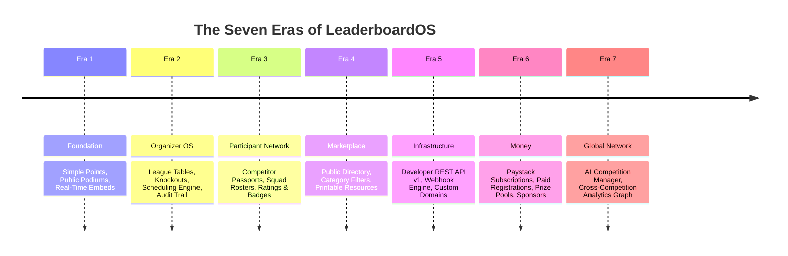

# The LeaderboardOS User Guide & Product Bible

> **The Authoritative Product Usage, Onboarding, Training, and Client Demonstration Manual.**
>
> *Target Audience:* Competition Organizers, Tournament Directors, League Managers, Matchday Referees, Competitors, and Organization Administrators.

---

## Table of Contents

- [1. Welcome to LeaderboardOS](#1-welcome-to-leaderboardos)
- [2. First-Time Onboarding](#2-first-time-onboarding)
- [3. Organizer's Complete Guide](#3-organizers-complete-guide)
- [4. Participant's Complete Guide](#4-participants-complete-guide)
- [5. Public Viewing, Discovery & Embeds](#5-public-viewing-discovery--embeds)
- [6. Billing & Payments](#6-billing--payments)
- [7. Troubleshooting & Frequently Asked Questions](#7-troubleshooting--frequently-asked-questions)
- [8. Feature Reference Matrix](#8-feature-reference-matrix)
- [9. The Seven Eras Client Learning Journey](#9-the-seven-eras-client-learning-journey)
- [10. Client Demonstration & Onboarding Playbook](#10-client-demonstration--onboarding-playbook)

---

## 1. Welcome to LeaderboardOS

### 1.1 What LeaderboardOS Does
**LeaderboardOS** is an all-in-one competition management platform designed to replace messy spreadsheets, manual bracket drawings, and fragmented score-tracking apps. Whether you are running a weekend 5-a-side football league, an esports gaming tournament, a corporate sales sprint, or a continuous crossfit challenge, LeaderboardOS allows you to set up rules, generate schedules, track live scores, and display gorgeous real-time standings in under 60 seconds.

### 1.2 Who Can Use It (Supported User Roles)
- **Competition Organizers & Tournament Directors**: Full administrative authority to create competitions, customize scoring rules, schedule fixtures, assign venues, manage sponsors, and distribute prizes.
- **Matchday Operators & Referees**: Authorized personnel assigned to input scores, record cards/penalties, and log match events in real time from the field or console.
- **Participants & Competitors**: Players and team captains who maintain a unified "Competition Passport", register for tournaments, submit squad rosters, and share verified achievements.
- **Organization Administrators**: Enterprise or club managers who oversee multiple competitions under a unified brand with custom domains.
- **Public Spectators & Fans**: Anyone viewing live leaderboards, tracking standings on mobile via QR codes, or inspecting embedded tournament brackets on community websites.

### 1.3 Supported Competition Types Today
1. **Simple Points Leaderboards**: Continuous participant rankings based on accumulated points or high scores (ideal for gaming high-scores, sales quotas, fitness reps, or hackathons).
2. **Round-Robin League Tables**: Multi-week leagues with scheduled fixtures, home/away ties, win/draw/loss tables, goal differentials, and customizable tie-breakers (ideal for football, basketball, and gaming leagues).
3. **Knockout Elimination Tournaments**: Single-elimination binary brackets (4 to 64 teams) with automatic winner advancement to semi-finals and championship games.

### 1.4 Sandbox Demo Mode vs Live Supabase Mode
LeaderboardOS includes a built-in **Demo Sandbox Mode**:
- When visiting the application without connecting a database, it automatically runs locally using browser storage. You can test 100% of the creation, scheduling, and scoring workflows with pre-populated sample data.
- Look for the green **"Demo Sandbox"** badge in the header. When you connect live Supabase and Paystack credentials, the application transitions to production database storage seamlessly.

---

## 2. First-Time Onboarding

### 2.1 Accessing the Application
Navigate to your LeaderboardOS instance (e.g. `https://leaderboardos.com` or `http://localhost:3000` in development).

### 2.2 Signing In & Account Setup
1. Click the **"Sign In"** button in the top navigation bar.
2. Choose your sign-in method:
   - **Google OAuth**: One-click authentication using your Google account.
   - **Email Magic Link**: Enter your work or personal email address to receive a passwordless login link.
   - **Demo Sandbox Mode**: If running locally without credentials, simply click "Enter Demo Sandbox" to instantly log in as the default demo organizer.
3. Upon first sign-in, you will be prompted to enter your **Display Name** and claim your unique **Competition Handle** (e.g., `@alex_striker`), which forms your persistent Competition Passport URL (`/passport/alex_striker`).

### 2.3 The Organizer Dashboard Overview
Upon logging in, you land on `/dashboard`:
- **Top Metrics**: Total active competitions, total registered participants, matches scheduled, and revenue collected.
- **Active Competitions Grid**: Quick access cards for your currently running leagues and tournaments with live status indicators (`Draft`, `Registration`, `In Progress`, `Completed`).
- **Quick Actions**: Buttons to **"Create Competition"**, **"AI Assistant"**, **"Analytics"**, and **"Organization Settings"**.

---

## 3. Organizer's Complete Guide

Every operational workflow is documented below with prerequisites, exact step-by-step instructions, expected system feedback, warnings, and error solutions.

### 3.1 Creating and Configuring a Competition
- **Purpose**: Bootstrap a new competition with customized branding, domain rules, and scoring parameters.
- **Prerequisites**: An authenticated organizer account.
- **Step-by-Step Instructions**:
  1. Click **"+ New Competition"** or navigate to `/dashboard/create`.
  2. **Step 1 — Format Selection**: Choose from **Simple Points Leaderboard**, **League Table**, or **Knockout Tournament**. Alternatively, click **"Use a Template"** to pre-fill settings (e.g., "Premier Football League", "Esports CS:GO Bracket", "Sales Leaderboard").
  3. **Step 2 — Details & Branding**: Enter a competition title (e.g., "Lagos Tech League 2026"), optional description, and customize your URL slug (`/leaderboards/lagos-tech-league`).
  4. **Step 3 — Rules & Scoring**: Specify points awarded for a win (default 3), draw (default 1), or custom point milestones.
  5. **Step 4 — Visibility**: Select **Public** (listed in the marketplace directory and discoverable) or **Private** (accessible only via direct link).
  6. Click **"Create Competition"**.
- **What You Should See**: A celebratory confetti animation and instant redirection to your competition dashboard at `/dashboard/leaderboards/[id]`.
- **Warnings**: The URL slug cannot be changed once public results have been recorded to prevent breaking spectator links and QR codes.
- **Common Errors**:
  - *Error: "Slug already taken"*: Choose a unique URL identifier or append the current year (e.g. `lagos-tech-league-2026`).

### 3.2 Managing a Simple Points Leaderboard
- **Purpose**: Award or deduct points for members and maintain an auditable public ranking.
- **Prerequisites**: A competition created with the `simple_points` type.
- **Step-by-Step Instructions**:
  1. Open your competition at `/dashboard/leaderboards/[id]`.
  2. Click **"+ Add Member"** to enter competitor names or import a batch via CSV.
  3. To award points, click the **"Score"** button beside any competitor row.
  4. Enter the point delta (e.g. `+25`), select a rule tag (e.g. "MVP Bonus", "Bug Bounty Closed"), and enter an optional note.
  5. Click **"Submit Score Event"**.
- **What You Should See**: The competitor's total score increases instantly, their rank position re-evaluates, and an audit card appears in the Activity Log.
- **Confirmation**: Open the public view (`/leaderboards/[slug]`) in a separate browser tab to confirm the podium updates in real time.

### 3.3 Managing a League Table Competition
- **Purpose**: Run multi-round leagues with automatic win/loss/draw calculation and goal differentials.
- **Prerequisites**: A competition created with the `league_table` type.
- **Step-by-Step Instructions**:
  1. Navigate to `/dashboard/leaderboards/[id]`.
  2. Switch to the **"Teams & Rosters"** tab and add your participating clubs or squads.
  3. Switch to the **"Fixtures"** tab. Click **"Generate Schedule"** to automatically pair teams in round-robin matchdays (or click "+ Add Fixture" to create manual ties).
  4. Once a match finishes, click **"Enter Result"** on the fixture row.
  5. Input the Home Score and Away Score (e.g., `2 - 1`).
  6. Click **"Save Result"**.
- **What You Should See**: The league standings table immediately recalculates: Played (`P`), Won (`W`), Drawn (`D`), Lost (`L`), Goals For (`GF`), Goals Against (`GA`), Goal Difference (`GD`), and Points (`PTS`).
- **Confirmation**: Check the standings table to verify the winning team gained 3 points and the GD updated accurately.

### 3.4 Managing a Knockout Tournament
- **Purpose**: Run single-elimination tournament brackets with automatic winner advancement.
- **Prerequisites**: A competition created with the `tournament` type.
- **Step-by-Step Instructions**:
  1. In the competition dashboard, navigate to the **"Bracket"** tab.
  2. Click **"Seed Participants"**. Choose **Random Seeding** or **Manual Seeding** to place teams into Round 1 match slots.
  3. When a match takes place, click on the match node in the interactive bracket.
  4. Enter the final score and select the confirmed winning team.
  5. Click **"Confirm Match Outcome"**.
- **What You Should See**: The winner's team name and logo automatically animate and advance to the connected match slot in the next round (e.g. from Quarter-Final to Semi-Final).
- **Warnings**: Overriding a previous round winner after subsequent rounds have been played will prompt a warning to reset dependent downstream matches.

### 3.5 Configuring Scoring Rules and Tie-Breakers
- **Purpose**: Customize how points and ties are resolved in complex sporting or gaming scenarios.
- **Prerequisites**: Organizer or admin access.
- **Step-by-Step Instructions**:
  1. In your competition dashboard, navigate to the **"Rules & Scoring"** tab.
  2. Adjust **Points for Win** (default: 3), **Points for Draw** (default: 1), and **Points for Loss** (default: 0).
  3. Under **Tie-Breaker Hierarchy**, drag and drop the prioritized tie-break rules:
     - *Goal / Score Differential*
     - *Total Goals / Points Scored*
     - *Head-to-Head Result*
     - *Fewest Disciplinary Cards / Penalties*
     - *Coin Toss / Alphabetical*
  4. Click **"Save Rules"**.
- **What You Should See**: Standings immediately re-order to reflect your new tie-breaker sequence.

### 3.6 Automated Scheduling & Fixture Generation
- **Purpose**: Generate a complete round-robin calendar with balanced home/away distribution and assigned venues.
- **Prerequisites**: At least 3 registered teams in a league competition.
- **Step-by-Step Instructions**:
  1. Open the **"Scheduler"** tab at `/dashboard/leaderboards/[id]`.
  2. Set your parameters:
     - **Match Days**: Select days of the week matches can be played (e.g., Saturday, Sunday).
     - **Start Date**: Select tournament kick-off date.
     - **Venues**: Add pitches or courts (e.g., "Pitch 1", "Court A").
     - **Match Duration & Interval**: e.g., 60 minutes with 15-minute turnaround.
  3. Click **"Generate Balanced Schedule"**.
- **What You Should See**: A complete schedule divided into numbered rounds (`Round 1`, `Round 2`, etc.) with assigned venues and times, guaranteed with zero team overlap.

### 3.7 Result Corrections & Audit Trails
- **Purpose**: Correct mistakenly entered scores while maintaining transparency and trust.
- **Prerequisites**: Organizer or Referee access.
- **Step-by-Step Instructions**:
  1. Locate the fixture requiring correction in the Fixtures tab.
  2. Click the three dots `...` and select **"Edit Result / File Correction"**.
  3. Input the corrected score.
  4. **Mandatory Step**: Enter the **Change Reason** (e.g., "Referee score card transcription typo; verified via match video").
  5. Optional: Paste an **Evidence URL** (e.g., link to match recording or official scorecard).
  6. Click **"Apply Correction"**.
- **What You Should See**: Standings recalculate. The fixture row displays an "Edited" badge. Clicking the badge opens the [ResultAuditDrawer](file:///c:/Users/DELL/Documents/leaderboard/src/components/competition/ResultAuditDrawer.tsx), revealing the exact revision history, author, timestamp, and justification.

### 3.8 Multi-Stage Competitions and Pathways
- **Purpose**: Connect a preliminary group stage league to a championship knockout playoff.
- **Prerequisites**: An existing league competition and a separate tournament competition.
- **Step-by-Step Instructions**:
  1. Open the League competition dashboard and click **"Stages & Pathways"**.
  2. Select **"Connect to Knockout Playoff"** and choose your tournament.
  3. Set the qualification threshold: e.g. "Top 4 teams advance".
  4. When the league stage completes, click **"Finalize & Advance Qualifiers"**.
- **What You Should See**: The top 4 teams from the league table are automatically seeded into the Quarter-Finals of the target tournament bracket.

### 3.9 Live Event-Day Operations
- **Purpose**: Run live matches from the field with a high-contrast, touch-friendly referee console.
- **Prerequisites**: Competition status set to `'in_progress'`.
- **Step-by-Step Instructions**:
  1. In the organizer dashboard, click the **"Event Day Console"** button or navigate to `/dashboard/leaderboards/[id]/event-day`.
  2. The console displays the currently active and upcoming matches for today.
  3. Click **"Kick Off"** to start the match clock.
  4. Tap the `+` buttons to record live goals, points, or disciplinary cards as they occur.
  5. Tap **"Final Whistle"** to conclude the match.
- **What You Should See**: Scores sync directly to public spectator screens in real time.

### 3.10 Using the AI Competition Manager
- **Purpose**: Ask natural language questions about your competition, draft announcements, or generate fixtures using an AI assistant grounded in your real competition data.
- **Prerequisites**: Organizer access to any competition.
- **Step-by-Step Instructions**:
  1. In the competition dashboard, click the floating **"AI Assistant"** tab on the right side of the screen.
  2. Ask questions such as:
     - *"Explain why Lagos United is ranked 2nd instead of 1st."*
     - *"Draft an Instagram announcement summarizing yesterday's match results."*
     - *"Propose a 4-round schedule for our 8 teams starting this Saturday."*
  3. **For Action Proposals**: When the AI proposes an action (such as creating a schedule or changing win points), a **Structured Proposal Card** appears in the chat.
  4. Review the human-readable diff.
  5. Click **"Accept & Apply"** to execute the change, or **"Reject"** to discard.
- **What You Should See**: The action executes safely through domain services with zero hallucination risk.

---

## 4. Participant's Complete Guide

### 4.1 Participant Passports & Profiles
Every competitor on LeaderboardOS receives a permanent, public **Competition Passport** accessible at `/passport/[handle]` (e.g. `/passport/king_arthur`).
- **Unified Competition History**: View all tournaments, leagues, and high-score boards you have ever competed in.
- **Performance Record**: Lifetime matches played, win rate percentage, and podium finishes.
- **Claiming a Profile**: If an organizer created a player entry using your name, click **"Claim This Profile"** on the competition page to link the historic record to your authenticated passport.

### 4.2 Teams and Squad Management
- **Creating a Team**: From your passport dashboard, click **"Create Team"** to register a squad with a team name, custom badge/logo, and color theme.
- **Rosters & Invites**: Invite teammates by sharing an invite link. Team captains can assign jersey numbers, player positions, and submit squad rosters to open leagues.

### 4.3 Registering for a Competition
1. Visit the public page of any competition in the registration phase (`/leaderboards/[slug]`).
2. Click the prominent **"Register Now"** button.
3. Select whether you are registering as a **Solo Participant** or submitting a **Team Squad**.
4. Fill out required entry questions (e.g., Discord handle, jersey size, emergency contact).
5. If the organizer has set an entry fee, you will be redirected to the secure Paystack checkout modal.
6. Upon payment confirmation, you receive an automated confirmation email with your registration ticket and schedule details.

### 4.4 Understanding Ratings and Achievements
- **Skill Ratings (Elo/Glicko)**: When competing in rated leagues or tournaments, your rating updates dynamically after each match based on your opponent's relative skill level.
- **Achievement Badges**: Earn automated badges displayed on your passport, including:
  - *Undefeated Season*: Win a league without a single loss.
  - *Sharpshooter*: Record the highest goal/point differential in a tournament.
  - *Century Club*: Compete in over 100 verified fixtures.

### 4.5 Sharing Results on Social Media
1. On any completed match or leaderboard podium, click the **"Share Result"** button.
2. Select your layout (Square for Instagram, Horizontal for Twitter/LinkedIn).
3. The platform generates a dynamic, branded OpenGraph image featuring your final rank, match score, team logos, and a QR code linking directly to the verified competition record.

---

## 5. Public Viewing, Discovery & Embeds

### 5.1 Public Competition Views
Every public competition is rendered at `/leaderboards/[slug]`:
- **Podium Showcase**: Top 3 ranked competitors or teams are highlighted on a high-contrast, gold/silver/bronze podium with player avatars.
- **Interactive Search**: Spectators can search for specific players or filter by division.
- **Mobile QR Code**: Spectators at live venues can scan the on-screen QR code to load the standings on their personal phones instantly.

### 5.2 Discovering Public Competitions
Browse all public events at `/directory`:
- Filter by category: **Sports**, **Esports & Gaming**, **Workplace & Sales**, **Fitness**, or **Education**.
- Filter by competition engine: **Leagues**, **Tournaments**, or **Points Boards**.
- Click **"Quick View"** on any card to inspect the current top 5 standings without leaving the directory.

### 5.3 Embedding Competitions
Organizers can embed live leaderboards or tournament brackets directly into their own website, blog, or community portal using a responsive iframe:

```html
<iframe
  src="https://leaderboardos.com/embed/lagos-tech-league?theme=dark&podium=true"
  width="100%"
  height="700"
  frameborder="0"
  allowtransparency="true"
></iframe>
```

#### Supported URL Query Parameters:
| Parameter | Values | Default | Description |
| :--- | :--- | :--- | :--- |
| `theme` | `dark`, `light`, `neon` | `dark` | Sets the visual aesthetic of the embed. |
| `podium` | `true`, `false` | `true` | Shows or hides the top 3 podium showcase. |
| `header` | `true`, `false` | `false` | Shows or hides the LeaderboardOS navigation header. |
| `round` | Integer (e.g. `1`, `2`) | Current | Focuses a league view on a specific round number. |

### 5.4 Free Public Tools
LeaderboardOS provides free, zero-login browser tools for the community:
- [Elo Calculator](file:///c:/Users/DELL/Documents/leaderboard/src/app/tools/elo-calculator/page.tsx) (`/tools/elo-calculator`)
- [League Table Generator](file:///c:/Users/DELL/Documents/leaderboard/src/app/tools/league-table-generator/page.tsx) (`/tools/league-table-generator`)
- [Tournament Bracket Generator](file:///c:/Users/DELL/Documents/leaderboard/src/app/tools/tournament-generator/page.tsx) (`/tools/tournament-generator`)
- [Downloadable Excel League Templates](file:///c:/Users/DELL/Documents/leaderboard/src/app/resources/excel-league-table-template/page.tsx) (`/resources/excel-league-table-template`)

---

## 6. Billing & Payments

### 6.1 LeaderboardOS SaaS Plans
LeaderboardOS offers flexible subscription tiers for organizers:
- **Free Tier (₦0 / month)**: Create up to 2 competitions with up to 32 participants each. Full access to points boards, leagues, and tournament brackets.
- **Pro Tier (₦10,000 / month)**: Unlimited competitions, up to 256 participants per competition, custom branding, API key access, AI competition manager, and CSV data exports.
- **Business Tier (₦50,000 / month)**: Unlimited participants, multi-admin staff seats, custom domain routing (e.g. `arena.yourclub.com`), and dedicated priority webhooks.

### 6.2 Paid Competition Registration Fees
Organizers can collect player or team entry fees directly through their competitions:
1. In the competition settings, enable **"Paid Registration"**.
2. Specify the entry fee in Nigerian Naira (e.g., `₦5,000`).
3. Participants must complete checkout via Paystack before their entry is confirmed on the roster.

### 6.3 Managing Finances, Prizes, and Refunds
Located in the competition dashboard under `/dashboard/leaderboards/[id]/finance`:
- **Financial Ledger**: An auditable real-time record of all registration fee inflows and prize outflows.
- **Prize Allocation**: Define prize pool splits (e.g., 1st Place: 60%, 2nd Place: 30%, 3rd Place: 10%).
- **Issuing Refunds**: If a player or team withdraws before registration closes, organizers can issue a verified refund directly through the finance console, which records a corresponding debit in the competition ledger.

### 6.4 Competition Sponsorship Management
Monetize your competition by displaying sponsors on public pages and live streams:
1. Navigate to the **"Sponsors"** tab in your dashboard.
2. Add sponsor details: Sponsor Name, Logo Image, Destination Website URL, and Sponsorship Tier (e.g. *Title Sponsor*, *Gold Partner*, *Beverage Partner*).
3. The platform displays high-visibility banner placements on `/leaderboards/[slug]` and tracks real-time impression and click-through metrics.

---

## 7. Troubleshooting & Frequently Asked Questions

### 7.1 Troubleshooting Matrix

| Problem / Symptom | Likely Cause | Recommended Safe Solution | When to Escalate |
| :--- | :--- | :--- | :--- |
| **Cannot sign in or receive magic link** | Email typo or strict spam firewall filtering. | Check spam/junk folders. If in local development, confirm `NEXT_PUBLIC_SUPABASE_URL` is set or use Demo Sandbox Mode. | Escalate if Google OAuth returns an invalid client ID error. |
| **Created competition is missing from dashboard** | Created under a different email account or demo localStorage was cleared. | Confirm you are logged into the correct profile. In demo mode, clearing browser cookies/cache resets local storage. | Escalate if using production database and SQL query confirms user ID match. |
| **Standings table does not update after match** | Fixture was saved as "In Progress" rather than "Completed", or cache delay. | Open the fixture and verify its status is set to `Completed`. Hard refresh browser page (`Ctrl+F5`). | Escalate if `fixture_result_history` shows the entry but standings points remain unchanged. |
| **Tournament bracket winner did not advance** | Draw recorded without a designated penalty/overtime winner. | Knockout matches must have a decisive winner. Re-open the match node and designate the winning team. | Escalate if single elimination match has a winner but parent node slot remains empty. |
| **Embed iframe displays scrollbars or gets cut off** | Embed container has fixed height smaller than standings table. | Increase `iframe height` to at least `750px` or set `width="100%"`. Add `overflow: hidden;` to container. | Escalate if custom CSS on host site interferes with iframe cross-origin sizing. |
| **Spectator screen does not update in real time** | Supabase Realtime publication disabled on `score_events` table. | Confirm `alter publication supabase_realtime add table score_events;` has been executed in database. | Escalate if websocket connection in browser network tab returns 401 Unauthorized. |
| **Participant registration payment failed** | Insufficient funds, expired card, or Paystack webhook secret mismatch. | Direct participant to retry with an alternate card or bank transfer. Check `/api/payments/diagnostics` for webhook health. | Escalate to Paystack support if customer was debited but status shows "abandoned". |

---

## 8. Feature Reference Matrix

| Feature Name | Primary Purpose | User Roles | Dashboard Location / URL | Dependencies |
| :--- | :--- | :--- | :--- | :--- |
| **Competition Creator** | Wizard to initialize competitions | Organizers | `/dashboard/create` | Auth |
| **Simple Points Engine** | Points accumulation & rankings | Organizers, Referees | `/dashboard/leaderboards/[id]` | None |
| **League Table Engine** | Round-robin tables & GD | Organizers, Referees | `/dashboard/leaderboards/[id]` | `competition_rules` |
| **Knockout Bracket Engine**| Single elimination tournaments | Organizers, Referees | `/dashboard/leaderboards/[id]` | Teams / Seeding |
| **Automated Scheduler** | Generate round-robin calendar | Organizers | `/dashboard/leaderboards/[id]` | Teams ($\ge 3$) |
| **Result Audit Drawer** | Inspect score change history | Organizers, Spectators | Click "Edited" on any match | `fixture_result_history` |
| **Event-Day Console** | Field-level live referee console | Organizers, Referees | `/dashboard/leaderboards/[id]/event-day` | Active fixtures |
| **AI Competition Manager**| Grounded competition co-pilot | Organizers | `/dashboard/leaderboards/[id]` | Gemini / Heuristics |
| **Competition Passport** | Universal competitor identity | Participants | `/passport/[handle]` | Auth Profile |
| **Team Management** | Squad rosters and captains | Team Captains | `/dashboard/passport` | Auth Profile |
| **Public Marketplace** | Discover public events | Spectators | `/directory` | Public competitions |
| **Embed System** | iFrame widget for external sites| Organizers, Media | `/embed/[slug]` | Public competition |
| **Developer API v1** | REST API for custom scoring | Developers | `/dashboard/developer` | Pro/Business Plan |
| **Sponsorship Tracker** | Manage sponsor banners & ads | Organizers | `/dashboard/leaderboards/[id]` | Active competition |
| **Financial Ledger** | Track cashflow & prize pools | Organizers | `/dashboard/leaderboards/[id]/finance` | Paystack keys |
| **Data Graph Analytics** | Cross-competition intelligence | Organizers | `/dashboard/analytics` | Multiple competitions |

---

## 9. The Seven Eras Client Learning Journey

LeaderboardOS is engineered along seven transformative product eras:



1. **Era 1 — Foundation (Implemented)**: The rock-solid core. Set up high-contrast score leaderboards with instant QR code sharing and embedded widgets for external websites.
2. **Era 2 — Organizer OS (Implemented)**: Professional league and tournament management. Automated round-robin scheduling, customizable tie-breakers, and transparent score audit trails.
3. **Era 3 — Participant Network (Implemented)**: Competitors take center stage. Every player gains a permanent Competition Passport to carry their match stats, team rosters, and Elo ratings across seasons.
4. **Era 4 — Competition Marketplace (Implemented)**: Spectators and teams discover local and global tournaments through an indexed, SEO-optimized public directory.
5. **Era 5 — Infrastructure (Implemented)**: Powering developers and organizations. Secure REST API keys, outbound event webhooks, and white-label custom domain branding.
6. **Era 6 — Money (Implemented / Requires Configuration)**: Turn competitions into viable businesses with paid player entry fees, financial ledgers, automated prize allocations, and corporate sponsorship banners.
7. **Era 7 — Global Competition Network (Implemented)**: Cross-competition intelligence. Natural-language AI co-pilot, relational data graph analytics, and streaming CSV data exports.

---

## 10. Client Demonstration & Onboarding Playbook

Use this battle-tested playbook when demonstrating LeaderboardOS to prospective clients, sports league commissioners, corporate executives, or tournament organizers.

### 10.1 The 2-to-3 Minute Executive Elevator Pitch
> *"Hello! Every sports league, gaming community, and company runs competitions, but almost all of them are stuck using messy Excel sheets, paper scorecards, and disconnected WhatsApp groups.
>
> LeaderboardOS is the world's first unified Competition Operating System. In less than 60 seconds, you can spin up a professional football league, gaming tournament, or sales leaderboard. It generates your round-robin schedule automatically, gives your referees a live mobile scoring console, calculates complex tie-breakers instantly, and provides your fans with a live, real-time public leaderboard with QR codes.
>
> Best of all, your players get permanent Competition Passports that track their stats and ratings across seasons. Let me show you how it works in action!"*

### 10.2 The 10-to-15 Minute Guided Demonstration Script
1. **Minute 0–2: Instant Creation Walkthrough**:
   - Open `/dashboard/create`.
   - Select the **"Football League"** preset. Title it *"Metro Football Championship"*.
   - Point out how default scoring rules (3 pts win, 1 pt draw) and tie-breakers are automatically configured.
   - Click **"Create Competition"**. (Demonstrate the instant speed).
2. **Minute 2–5: Automated Scheduling & Teams**:
   - Show the pre-populated teams in the Teams tab.
   - Click the **"Scheduler"** tab. Click **"Generate Balanced Schedule"**.
   - Show how 10 matchdays are instantly distributed across "Pitch 1" and "Pitch 2" with zero scheduling conflicts.
3. **Minute 5–8: The Event-Day Scoring Experience**:
   - Click **"Event Day Console"** (`/event-day`).
   - Simulate a live match: start the match clock, tap `+` to record two goals for the home team. Click **"Final Whistle"**.
   - Return to the League Standings tab. Highlight how the win points, goal differential, and table positions updated without a page reload.
4. **Minute 8–11: Public Fan Experience & Embeds**:
   - Open the public page (`/leaderboards/metro-football-championship`).
   - Show the animated top-3 podium and point out the mobile QR code.
   - Open the embed view (`/embed/metro-football-championship?theme=dark`) to show how it embeds directly into their official club website.
5. **Minute 11–13: The AI Competition Manager**:
   - Open the AI Assistant panel.
   - Prompt: *"Summarize today's match results and explain why Team Alpha is top of the table."*
   - Show how the AI provides a factual, grounded explanation based on real match data.
6. **Minute 13–15: Q&A and Handover**:
   - Answer client questions regarding their specific sport or team structure.

### 10.3 The 30-Minute Deep Organizer Onboarding Walkthrough
For clients who have signed up and need full staff training:
- **Minutes 0–5**: Account setup, staff invites, and organization workspace branding.
- **Minutes 5–12**: Setting up custom scoring rules, disciplinary point deductions, and multi-stage pathways (Group Stage $\rightarrow$ Knockout Finals).
- **Minutes 12–18**: Referee onboarding: training field operators on the Event-Day mobile interface and demonstrating how score corrections with audit reasons work.
- **Minutes 18–24**: Setting up paid player registrations, connecting Paystack API keys, and configuring prize pool splits in the financial ledger.
- **Minutes 24–28**: Adding tournament sponsor banners and reviewing impression tracking.
- **Minutes 28–30**: Final launch checklist and verification.

### 10.4 Discovery Questions to Ask the Client
1. *What format do your competitions follow? (Single round-robin, home & away leagues, or knockout brackets?)*
2. *How many teams and matches do you manage in a typical season?*
3. *How do you currently resolve ties? (Goal difference, head-to-head records, or fair play cards?)*
4. *Do you charge teams an entry fee or distribute cash prizes?*
5. *Do you have an existing website where you would like to embed the live leaderboard?*

### 10.5 Client Readiness Confirmation Checklist
Before handing over a competition to live operations:
- [ ] Competition details, logo, and custom slug are finalized.
- [ ] Scoring rules and tie-breakers match the official tournament rulebook.
- [ ] All participating teams and rosters are registered.
- [ ] Schedule generated and verified for venue or time conflicts.
- [ ] Referees invited and verified access to the Event-Day Console.
- [ ] Public page and embed tested on mobile and desktop browsers.
- [ ] (If paid) Paystack credentials verified with a ₦100 test transaction.

> [!NOTE]
> **Important Distinction Between Demo and Production Data**: During client demonstrations, ensure you point out whether you are using the pre-seeded **Demo Sandbox Mode** or a live **Supabase Production Workspace**. Demo data is stored locally in the browser and will not affect client accounts or real customer records.
